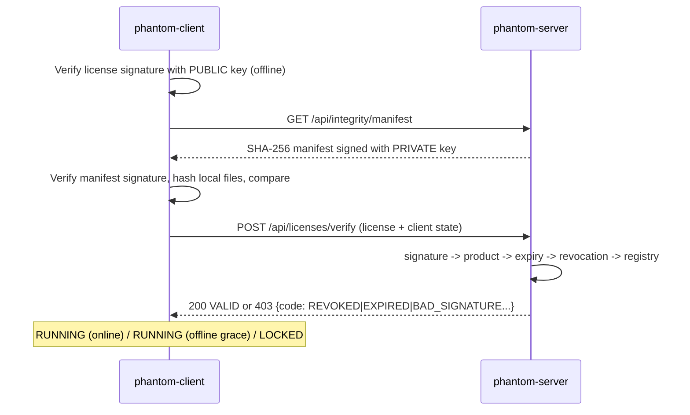

# PHANTOM: Containerised Software Protection, DRM & Anti-Tamper Simulation

PHANTOM is a small software-protection platform built for teaching. It shows how commercial
protection systems (in the spirit of products like Denuvo) combine **licensing**,
**cryptographic signatures**, **integrity verification** and **anti-tamper checks**. It runs as a
**Docker Compose** stack on Windows, and its license server can also be deployed to **Render**
with **GitHub Actions** CI/CD.

> **Educational scope.** PHANTOM protects only its own sample files (`sample_app/`). It does not
> interact with, analyse, crack or bypass any commercial software or third-party DRM.

| Docs | |
|---|---|
| [docs/DEMO_SCRIPT.md](docs/DEMO_SCRIPT.md) | Step-by-step faculty demonstration (about 12 minutes) |
| [docs/CONCEPTS.md](docs/CONCEPTS.md) | Skill Lab concept mapping (implemented vs. explained) |
| `http://localhost:8000/docs` | Interactive OpenAPI (Swagger) documentation |

---

## 1. Architecture

```
                         WINDOWS 11 HOST
                               |
                   DOCKER DESKTOP (WSL2 backend)
          one lightweight Linux VM -> one shared Linux kernel
                               |
                         DOCKER COMPOSE
                               |
             +------ phantom-net (bridge network) ------+
             |                                          |
   +---------v----------+     HTTP (service DNS)  +-----v----------------------+
   |  phantom-client    | ----------------------> |  phantom-server            |
   |  (protected app)   |  http://phantom-server  |  FastAPI + Uvicorn         |
   |                    |        :8000            |                            |
   | - public key only  |                         |  License engine (Ed25519)  |
   | - offline sig check|                         |  Validator (expiry/revoke) |
   | - SHA-256 integrity|                         |  Integrity engine (SHA-256)|
   | - env/debugger sim |                         |  Event logging -> SQLite   |
   | - offline grace    |                         |  Monitoring API /api/stats |
   +---------+----------+                         |  Dashboard (static files)  |
             |                                    +-----+----------------+-----+
     volume: phantom-client-data                        |                |
     (license, pinned key, app copy)       volume: phantom-server-data   | port 8000 -> host
                                           (SQLite DB, logs, dev keys)   |
                                                                  Browser: http://localhost:8000

   CLOUD:  GitHub push --> GitHub Actions (tests, config check, image build)
                       --> Render (Docker runtime, free plan) --> https://<app>.onrender.com
           The local client can point at Render by setting LICENSE_SERVER_URL.
```



### Components

| Path | Responsibility |
|---|---|
| `security/signing.py` | Ed25519 key generation and loading, license token issuance, document signing (server only) |
| `security/verification.py` | Public-key verification, license claim checks (used by both sides) |
| `security/hashing.py` | SHA-256 file and directory hashing, manifest comparison |
| `server/main.py` | FastAPI app factory, endpoints, admin auth, rate limiting, error handling |
| `server/license_manager.py` | Issues and revokes licenses. **The only holder of the private key.** |
| `server/validator.py` | Online validation pipeline and HTTP status mapping |
| `server/integrity.py` | Signed reference manifest and the tamper-simulation workspace |
| `server/database.py` | SQLite repository (licenses, events, client heartbeats) |
| `server/config.py` | Environment-based settings; dev vs. production secret handling |
| `client/main.py` | Protected application: CLI and protection loop |
| `client/license_client.py` | Standard-library HTTP client for the license server |
| `client/integrity.py` | Client integrity check plus simulated debugger and environment detection |
| `monitoring/logger.py` | JSON logs (server) and readable logs (client), with a small rotating log file |
| `dashboard/` | Monitoring dashboard in vanilla HTML, CSS and JS, served by FastAPI at `/dashboard/` |

---

## 2. Quick start (Windows 11 + Docker Desktop)

Prerequisites: Docker Desktop running and Python 3.12 (needed only for key generation and tests).

```powershell
# 1. Generate an Ed25519 key pair + admin secret into .env (gitignored)
python -m venv .venv
.\.venv\Scripts\pip install -r requirements-dev.txt
.\.venv\Scripts\python scripts\generate_keys.py      # prints the admin secret

# 2. Build and start the containers
docker compose build
docker compose up -d
docker compose ps                     # phantom-server should be "healthy"
docker compose logs -f phantom-client # Ctrl+C to stop following

# 3. Open the dashboard and unlock admin with PHANTOM_ADMIN_SECRET from .env
start http://localhost:8000

# 4. Activate a license in the client (copy the key from the dashboard)
docker compose exec phantom-client python -m client.main activate PHM1.xxxxx.yyyyy

# 5. Stop (data volumes are kept). Add -v to also delete the volumes.
docker compose down
```

> Skipping step 1 also works. In `development` mode the server generates a signing key and admin
> secret in its data volume and prints the secret once: `docker compose logs phantom-server | findstr ADMIN`.

### Client commands

```powershell
docker compose exec phantom-client python -m client.main check     # one check, exit code 0/1
docker compose exec phantom-client python -m client.main status    # local license + state
docker compose exec phantom-client python -m client.main tamper    # simulate a crack (modify file)
docker compose exec phantom-client python -m client.main delete    # delete a protected file
docker compose exec phantom-client python -m client.main restore   # reinstall original build
```

### Run the tests

```powershell
.\.venv\Scripts\python -m pytest -v
```

The suite has 45 tests covering valid, invalid, expired and revoked licenses, valid and forged
signatures, unmodified, modified, missing and injected files, health, authentication, validation
errors, rate limiting and production-secret enforcement.

---

## 3. How the protection works

### 3.1 Licensing (DRM)

A license is a signed token (similar in spirit to a compact JWT/JWS):

```
PHM1.<base64url(canonical JSON claims)>.<base64url(Ed25519 signature)>

claims = { license_id, product_id, licensee, issued_at, expires_at, key_id }
```

* **Generation** (`POST /api/licenses/generate`) requires the `X-Admin-Secret` header. The server
  signs the claims with its **private key** and stores a record (status `active`) in SQLite.
* **Offline verification.** The client has only the **public key**. It can check that the license
  is authentic, unmodified, unexpired and for the right product without network access.
* **Online verification** (`POST /api/licenses/verify`) adds **revocation** and logging. The
  validation pipeline is: format, then signature, then product, then time, then revocation, then registry.
* **License status** is `active`, `expired` (computed from `expires_at`) or `revoked` (server-side flag).

| Result code | HTTP | Meaning |
|---|---|---|
| `VALID` | 200 | Authentic, current, not revoked |
| `MALFORMED` | 400 | Not a decodable `PHM1` token |
| `BAD_SIGNATURE` | 403 | Forged or altered, or signed by another key |
| `EXPIRED` / `NOT_YET_VALID` | 403 | Outside the validity window |
| `PRODUCT_MISMATCH` | 403 | License is for a different product |
| `REVOKED` | 403 | Revoked in the registry or via `PHANTOM_REVOKED_LICENSES` |
| `UNKNOWN_LICENSE` | 403 | Only when `PHANTOM_STRICT_REGISTRY=true` |

**Why Ed25519?** It is asymmetric, so clients can verify but never sign. It is fast, has small keys
(32 bytes) that fit in an environment variable, and is deterministic, so a weak random number
generator cannot leak the key at signing time.

### 3.2 Integrity verification

1. On start-up the server hashes the pristine `sample_app/` with **SHA-256** and **signs the manifest**.
2. The client downloads the manifest, verifies its signature with the public key and caches it,
   so it can still be trusted offline.
3. The client hashes its installed copy and compares. Each file is reported as `OK`, `MODIFIED`,
   `MISSING` or `UNEXPECTED` (an injected file). Any non-OK file sets `FAIL` and locks the app.
4. Changes are also reported to `POST /api/integrity/verify`. The server logs a **critical**
   `TAMPERING DETECTED` event, which feeds the dashboard alerts.

The dashboard's *Integrity Lab* runs the same engine against a **disposable workspace copy** on the
server (modify, delete, inject, restore), so the pristine build in the image is never touched.
The server image filesystem is read-only.

### 3.3 Anti-tamper simulation

| Scenario | How to trigger | Expected result |
|---|---|---|
| Valid license | Activate a generated key | `APPLICATION RUNNING [ONLINE]` |
| Invalid / forged license | Dashboard **Forge license** (edits expiry, keeps signature) | `BAD_SIGNATURE`, critical event |
| Expired license | Dashboard **Expired license** (issued at -1 day) | `EXPIRED` |
| Revoked license | Dashboard **Revoke & verify**, or registry **Revoke** | Client locks on its next check |
| File modification | `client.main tamper` or **Modify file** | `MODIFIED`, app locked |
| Missing file | `client.main delete` or **Delete file** | `MISSING`, app locked |
| Server unavailable | `docker compose stop phantom-server` | Offline grace (60 s by default), then locked |
| Recovery | `docker compose start phantom-server` | Back to `RUNNING [ONLINE]` automatically |
| Debugger detection | `docker compose exec -e PHANTOM_SIMULATE_DEBUGGER=1 -e DEBUGGER_POLICY=block phantom-client python -m client.main check` | `LOCKED: debugger detected` |

**Debugger and environment detection (simulated).** The client checks for a Python trace hook
(pdb or IDE debuggers), a `TracerPid` in `/proc/self/status` (gdb or strace attached), and a demo
switch. It also *reports, but never blocks on*, container and hypervisor indicators and the kernel
version.

#### Limitations (important for an honest evaluation)

* **Client-side checks run on hardware the attacker controls.** Anyone who can edit
  `client/main.py` can delete the checks, which is exactly what real crackers do to binaries.
  Commercial systems raise the cost with obfuscation, code virtualisation and many redundant checks
  woven through the program, but they **delay** cracking rather than prevent it.
* Python is not compiled or obfuscated, so the "binary" here is completely transparent.
* Debugger checks are easy to fool: hook `sys.gettrace`, use a kernel-level debugger, or patch
  `/proc` reads. Blocking on VM or container detection would punish legitimate users, so PHANTOM only
  reports these signals.
* Trust on first use: if `PHANTOM_PUBLIC_KEY` is not configured, the client pins the server's key
  the first time it connects. Production should ship the key inside the application (set it in `.env`).
* The offline grace period is a trade-off between usability and the time a revoked license can
  still run while offline.
* PHANTOM deliberately does **not** implement stealth, kernel drivers, invasive surveillance, or
  techniques for evading security tools.

---

## 4. REST API

| Method | Path | Auth | Description |
|---|---|---|---|
| GET | `/health` | none | Liveness and readiness (DB check, key fingerprint, uptime) |
| GET | `/api/public-key` | none | Ed25519 public key and fingerprint |
| POST | `/api/licenses/generate` | admin | `{licensee, valid_days, product_id?}` returns 201 with `license_key` |
| POST | `/api/licenses/verify` | rate-limited | `{license_key, client_id?, client_state?}` returns 200 or 4xx with `code` |
| POST | `/api/licenses/revoke` | admin | `{license_id, reason?}` returns 200, 404 or 409 |
| GET | `/api/licenses` | admin | License registry |
| GET | `/api/integrity/manifest` | none | Signed SHA-256 reference manifest |
| POST | `/api/integrity/verify` | rate-limited | `{client_id?, files?}`. Compares client hashes, or the server workspace if `files` is omitted |
| POST | `/api/integrity/simulate` | admin | `{action: tamper\|delete\|inject\|restore}` (demo workspace only) |
| GET | `/api/events` | none | `?limit=&category=&severity=` security event log |
| GET | `/api/stats` | none | Aggregated monitoring data used by the dashboard |

* **Admin authentication:** the `X-Admin-Secret` header is compared in constant time
  (`hmac.compare_digest`). The response is 401 if the header is missing and 403 if it is wrong.
  Failures are logged as security events.
* **Rate limiting:** in-memory sliding window per client IP. The defaults are 120/min on public
  verification and 30/min on admin endpoints, which also slows brute-forcing of the admin secret.
  Over the limit the server returns 429 with `Retry-After`.
* **Errors** always use a JSON body: `{"error": "VALIDATION_ERROR", "message": ..., "details": [...]}`.
* **Hardening:** strict Pydantic models (`extra="forbid"`), size limits, `X-Content-Type-Options`,
  `X-Frame-Options`, and output escaping in the dashboard.
* **Secrets are never returned.** Tests assert that the private key never appears in any response.

---

## 5. Docker and virtualisation

### 5.1 Physical machines, VMs, hypervisors and containers

| | Physical machine | Virtual machine | Hypervisor | Container | Docker Engine |
|---|---|---|---|---|---|
| **What it is** | Real hardware running one OS | A complete emulated computer with its own guest OS and kernel | Software that creates and runs VMs (Type 1: Hyper-V, ESXi, KVM; Type 2: VirtualBox) | An isolated **process** on a shared kernel | Daemon and tools that build images and run containers |
| **Kernel** | Its own | Its own guest kernel | Manages hardware for guests | **Shares the host kernel** | Uses host kernel features |
| **Isolation mechanism** | Physical separation | Hardware virtualisation (VT-x/AMD-V) | Same | Linux **namespaces** (PID, net, mount, user...) and **cgroups** (CPU/memory limits) | Configures namespaces and cgroups |
| **Start-up time** | Minutes | Tens of seconds to minutes | n/a | Under a second to a few seconds | n/a |
| **Size** | n/a | GBs (full OS) | n/a | MBs (app plus userland only) | n/a |
| **Isolation strength** | Strongest | Strong (separate kernels) | n/a | Weaker: a kernel exploit affects every container | n/a |
| **Example in PHANTOM** | The Windows laptop | WSL2 utility VM that Docker Desktop runs | Windows' Virtual Machine Platform | `phantom-server`, `phantom-client` | Docker Desktop's engine |

**Docker is not a hypervisor.** Containers do not virtualise hardware and do not boot their own
kernel. On Linux, `docker run` starts an ordinary process that the kernel isolates with
namespaces and cgroups.

On **Windows**, Linux containers need a Linux kernel. Docker Desktop therefore runs **one small
Linux VM (WSL2)**, and *all* containers share that VM's kernel. PHANTOM shows this live: the
client logs and the dashboard display `kernel 6.x-microsoft-standard-WSL2` and `hypervisor_flag=True`.
Every container reports the **same** kernel, because they share it, whereas each VirtualBox VM
would report its own. No *additional* VMs, VirtualBox or manual Hyper-V setup were needed.

### 5.2 How PHANTOM uses containers for isolation

| Docker feature | Where | Purpose |
|---|---|---|
| **Images / Dockerfiles** | `server/Dockerfile`, `client/Dockerfile` | `python:3.12-slim`, dependency layer cached, non-root user, read-only `/app` |
| **Separation of secrets** | The client image contains no `server/` code and no private key | A compromised client cannot mint licenses |
| **Bridge network** | `phantom-net` | Private network. The client reaches the server by **service name** (`http://phantom-server:8000`) through Docker's embedded DNS, not `localhost` |
| **Port mapping** | `8000:8000` on the server only | The client exposes **no ports**, so it is reachable only from inside the network |
| **Volumes** | `phantom-server-data`, `phantom-client-data` | SQLite DB, logs, installed license and app copy survive `docker compose down` / `up` |
| **Environment variables** | `docker-compose.yml` reads `.env` | Same image runs in development, local production or Render |
| **Health checks** | `HEALTHCHECK` plus `depends_on: service_healthy` | Client starts after the server is ready; Docker can restart unhealthy containers |
| **Lifecycle** | `restart: unless-stopped` | Survives crashes and Docker Desktop restarts |
| **Hardening** | `read_only: true`, `tmpfs /tmp`, `no-new-privileges`, CPU and memory limits (cgroups) | Least privilege and resource control |

Disk usage: about 220 MB (server) and 200 MB (client) images, mostly the shared slim Python
base layers. The server log file is capped at about 3 MB and the event table at 5,000 rows.

---

## 6. Cloud deployment on Render (free plan)

Only the **license server** is deployed. It is the same `server/Dockerfile`, which already binds
`0.0.0.0:$PORT`, exposes `/health` and trusts Render's proxy headers. Render terminates **HTTPS**.

### Steps

1. Generate production secrets locally (do **not** reuse the dev `.env`):
   ```powershell
   .\.venv\Scripts\python scripts\generate_keys.py --print
   ```
2. In Render, choose **New, then Blueprint**, pick `ChinmaiShetti/phantom_hypervisor`. Render reads
   `render.yaml`:
   * runtime **Docker**, `dockerfilePath: ./server/Dockerfile`, `dockerContext: .`
   * plan **free**, health check `/health`
   * `autoDeployTrigger: checksPass`, so Render deploys only after GitHub Actions passes

   (Manual alternative: New, then **Web Service**, repo, Language **Docker**, Dockerfile path
   `server/Dockerfile`, Docker build context `.`, Instance type **Free**, Health check path `/health`.)
3. Set the environment variables (Render, then Environment):

   | Key | Value |
   |---|---|
   | `APP_ENV` | `production` |
   | `PHANTOM_PRIVATE_KEY` | from step 1 (**secret**) |
   | `PHANTOM_ADMIN_SECRET` | from step 1 (**secret**, 16+ chars) |
   | `PHANTOM_PRODUCT_ID` | `PHANTOM-DEMO` |
   | `PHANTOM_REVOKED_LICENSES` | optional, comma-separated IDs |

   Render sets `PORT` itself. Production **refuses to start** without the key and secret.
4. Verify: `https://<your-app>.onrender.com/health`, then open `/` for the dashboard.
5. Point the local client container at the cloud server. In `.env`:
   ```
   LICENSE_SERVER_URL=https://<your-app>.onrender.com
   PHANTOM_PUBLIC_KEY=<public key printed in step 1>
   ```
   Then run `docker compose up -d phantom-client`. Licenses must come from the cloud server's
   dashboard, because each server has its own key.

### Free-tier constraints and how PHANTOM handles them

* **Ephemeral filesystem.** SQLite on Render is wiped on every deploy, restart or spin-down. PHANTOM
  is therefore designed to be **stateless where it matters**:
  * licenses are **self-contained signed tokens**, so a valid signature proves issuance even after
    the registry is lost ("stateless registry" mode, the default)
  * the signing key lives in an **environment variable**, not on disk
  * revocations that must survive restarts go in `PHANTOM_REVOKED_LICENSES`
  * events and statistics on Render are **demo-session only**. Durable cloud storage needs an
    external database (for example PostgreSQL). `server/database.py` isolates all SQL for that migration.
* **Sleeps after about 15 minutes idle.** The first request after a sleep can take about a minute.
  The client treats that as "server unavailable" and keeps running inside its offline grace
  period, which is a realistic demonstration of why DRM needs offline tolerance. Open `/health`
  shortly before demonstrating.
* Rate-limiter state is per instance and in memory (fine for one free instance).

---

## 7. CI/CD

`.github/workflows/ci.yml` runs on **push to `main`** and **pull requests to `main`**:

| Stage | What it does |
|---|---|
| 1. Checkout | `actions/checkout` |
| 2. Set up Python | 3.12 with pip cache |
| 3. Install dependencies | `requirements-dev.txt` |
| 4. Run tests | `pytest -v`. Any failure fails the workflow (non-zero exit code) |
| 5. Validate configuration | Asserts production refuses to boot without secrets, boots with generated ones, and `docker compose config` is valid |
| 6. Build Docker images (job 2, `needs: test`) | Builds both images and smoke-tests `/health` in a real container |

* **Continuous Integration:** every commit is automatically built and tested, so broken code is
  caught before it reaches `main` (branch protection can require the check).
* **Continuous Deployment:** Render watches `main`. With `autoDeployTrigger: checksPass` it
  rebuilds and deploys the server image **only when CI is green**, and switches traffic to the
  new version once `/health` passes. (For a manually created service, set *Settings, then
  Auto-Deploy* to **After CI Checks Pass**.)
* **Secrets management:** no secret is committed. `.env` is gitignored, CI generates throwaway keys,
  and production secrets exist only in Render's environment settings.
* **Environments:** `APP_ENV=development` (auto-generated dev secrets, local Docker) vs.
  `production` (Render, strict secret requirements).

---

## 8. Environment variables

| Variable | Used by | Default | Notes |
|---|---|---|---|
| `APP_ENV` | server | `development` (`production` in the image) | `production` enforces secrets |
| `PHANTOM_PRIVATE_KEY` | server | auto (dev only) | Base64 raw Ed25519 seed. **Never** give it to clients |
| `PHANTOM_ADMIN_SECRET` | server | auto (dev only) | 16+ chars in production |
| `PHANTOM_PRODUCT_ID` | both | `PHANTOM-DEMO` | |
| `PHANTOM_REVOKED_LICENSES` | server | empty | Persistent revocation list |
| `PHANTOM_STRICT_REGISTRY` | server | `false` | Reject signed licenses that are missing from the DB |
| `DATA_DIR` | server | `/data` | SQLite, logs, dev keys |
| `PORT` | server | `8000` | Render injects this |
| `RATE_LIMIT_PER_MINUTE` / `ADMIN_RATE_LIMIT_PER_MINUTE` | server | 120 / 30 | |
| `PHANTOM_PUBLIC_KEY` | client | pinned on first use | |
| `LICENSE_SERVER_URL` | client | `http://phantom-server:8000` | Or the Render URL |
| `CLIENT_ID` | client | `phantom-client-01` | |
| `CHECK_INTERVAL_SECONDS` / `OFFLINE_GRACE_SECONDS` | client | 20 / 60 | |
| `DEBUGGER_POLICY` / `PHANTOM_SIMULATE_DEBUGGER` | client | `warn` / `0` | `block` locks the app |
| `HOST_PORT` | compose | `8000` | Host side of the port mapping |

---

## 9. Engineering decisions

* **Two containers, dashboard served by FastAPI.** Fewer moving parts and one public port.
* **The client uses only the standard library plus `cryptography`.** It has a smaller image and attack surface.
* **The shared `security/` package** is copied into both images, so the verification logic is
  identical on client and server and there is one source of truth.
* **App factory (`create_app(settings)`).** Each test gets an isolated app, database and key.
* **SQLite through a single repository class.** Zero setup locally and a clean path to PostgreSQL.
* **Signed integrity manifest.** Reference hashes are trustworthy even when cached offline.
* **No React, Redis or Kubernetes.** Nothing in the requirements needed them.

## 10. Implemented vs. not implemented

Implemented and tested: everything in sections 3 to 7 above.
**Not implemented** (possible extensions): hardware/machine binding of licenses, code obfuscation,
PostgreSQL backend, multi-instance rate limiting, key rotation with multiple `key_id`s, mTLS between
containers, and signed client-side audit logs.

## License

MIT. See [LICENSE](LICENSE).
